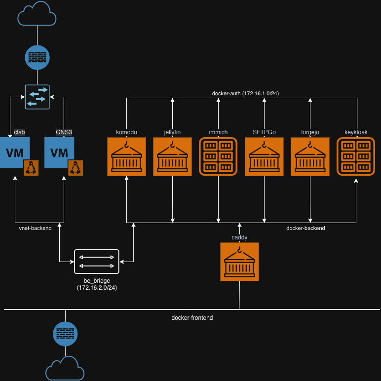

= PSAC #1
== Motivation
== History

== Setup local dev PC

== Run docker service

== Docker commands
=== run
`docker run <options> <image>` runs a container based on an image given.

=== EXPOSE
The `EXPOSE <port-no>/protocol` directive in the `Dockerfile`.

=== publish
The command `docker run --publish <HOST_IP>:<HOST_PORT>:<CONTAINER_PORT>` maps the `CONTAINER_PORT` to the `HOST_PORT` on the host. That's a way to avoid binding to privileged ports or run several containers that would bind to the same port.
`docker run --publish-all` maps all the `EXPOSED` ports on the host as-is.

_Note: -d is to detach from the console of the container_

=== volume

The `volume` command is to create a persistent storage *managed by Docker* this comes handy if you don't have to have access to the storage from the host, only from the container. Volumes can be mounted on the filesystem of the containers.

=== mount
The `mount` command is to bind mount a folder on the host machine to the container, creating a 'shared folder' between the guest and the host.

=== network
With the `network` subcommand docker networks can be defined which later could be attached to containers.

To create the docker part for the architecture below, the following commands were used.

=== exec
With the `exec` subcommand commands can be sent to running containers.

=== stop
With the `stop` subcommand running containers can be halted.

=== restart
With the `restart` command already existing but stopped containers can be restarted.

